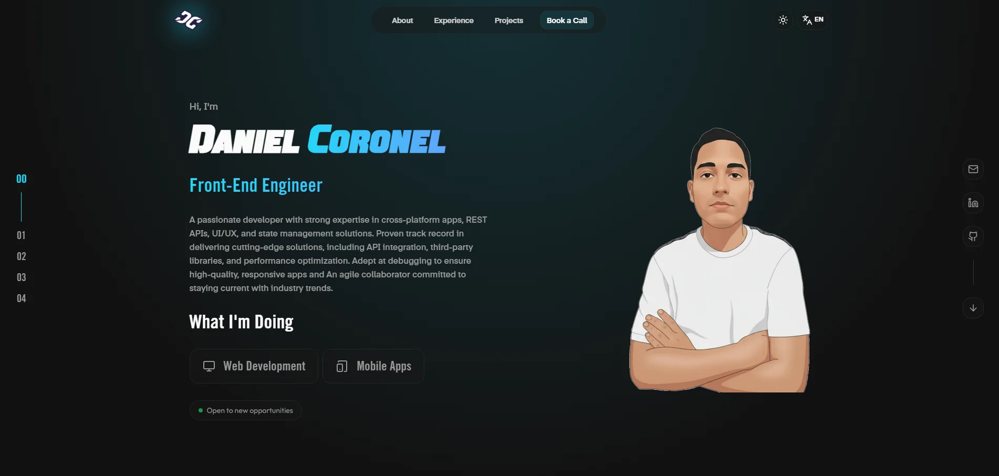

# 🚀 Modern Portfolio | Daniel Coronel

A professional, high-performance personal portfolio built with **React, TypeScript, and Vite**. This project showcases my journey as a Full Stack Developer, highlighting my projects, skills, and professional experience with a modern and interactive UI.

---

## 📄 About Me

I'm **Daniel Coronel**, a Full Stack Developer from Paraguay 🇵🇾. I specialize in building scalable, user-centric web applications. This portfolio represents my transition to a more robust tech stack, focusing on performance, internationalization (i18n), and advanced UI/UX patterns.  

---

## 📌 Key Improvements

Moving from my previous Angular portfolio, this new version includes:

- **Tech Stack Migration:** From Angular to React + Vite for faster build times and better developer experience.

- **Enhanced UI:** Implementation of Framer Motion for smooth animations and a 3D animated background.

- **Internationalization:** Full support for multiple languages (English/Spanish) using i18next.

- **Modern Styling:** Built with Tailwind CSS and Shadcn UI for a clean, consistent design.

---

## 🛠 Technologies used

- **React 18** (Frontend Library)

- **TypeScript** (Static Typing)

- **Vite** (Build Tool)

- **Tailwind CSS** (Utility-first Styling)

- **Framer Motion** (Animations)

- **Lucide React** (Icons)

- **i18next** (Internationalization)

- **Vercel** (Hosting & Deployment)

---

## ✨ Features

- **Responsive Design:** Fully optimized for all screen sizes.

- **Dark/Light Mode:** Integrated theme provider for better user experience.

- **Animated Components:** Interactive 3D cube background and smooth scroll transitions.

- **Multi-language Support:** Easily toggle between Spanish and English.

- **Contact Integration:** Functional contact modal for direct inquiries.

---

## 🌐 Live Demo

Check out the live site here:
👉 [danielcoronel.vercel.app](https://danielcoronel.vercel.app)

---

## 📸 Preview


---

## 🚀 How to Run Locally

```bash
# Clone the repository
git clone https://github.com/DanielCoronelPV/new-portfolio.git

# Navigate into the project folder
cd new-portfolio

# Install dependencies
npm install

# Run the development server
npm run dev

# The app will be available at
http://localhost:5173/
```

---

## 📁 Structure

```bash
PORTFOLIO-REACT/
├── public/                # Archivos públicos estáticos (robots, logos, etc.)
├── src/                   # Código fuente principal
│   ├── assets/            # Recursos visuales organizados por sección
│   │   ├── experiences/   # Imágenes de experiencia laboral
│   │   ├── fonts/         # Fuentes personalizadas
│   │   ├── projects/      # Capturas de proyectos
│   │   ├── skills/        # Iconos de tecnologías
│   │   ├── sliders/       # Imágenes para carruseles
│   │   └── profile-animated.webp
│   ├── components/        # Componentes de la interfaz
│   │   ├── ui/            # Componentes base y de Shadcn
│   │   ├── About.tsx
│   │   ├── AnimatedCubeBackground.tsx
│   │   ├── Contact.tsx
│   │   ├── Projects.tsx
│   │   └── ...            # Otros componentes (Hero, Navigation, Skills, etc.)
│   ├── config/            # Configuraciones globales
│   ├── hooks/             # Custom Hooks de React
│   ├── i18n/              # Configuración de traducciones (i18next)
│   ├── lib/               # Funciones de utilidad (utils.ts)
│   ├── pages/             # Vistas de alto nivel
│   │   ├── Index.tsx      # Página principal
│   │   └── NotFound.tsx   # Página de error 404
│   ├── App.tsx            # Componente raíz
│   ├── App.css            # Estilos globales de la aplicación
│   ├── main.tsx           # Punto de entrada de la aplicación
│   └── index.css          # Estilos base de Tailwind
├── .env.local             # Variables de entorno
├── components.json        # Configuración de Shadcn UI
├── package.json           # Dependencias y scripts
├── tailwind.config.ts     # Configuración de Tailwind CSS
├── vite.config.ts         # Configuración de Vite
└── README.md
```
